# Class diagram — Doctrine entities

Generated by reading every class in `src/Entity` (16 entities) and the two enums in `src/Enum` used as column types.
The same diagram in PlantUML is in [`class-diagram.puml`](class-diagram.puml).

## How to read it

- **Fields** are the real private properties with their PHP types (`?` = nullable). Every entity field is listed.
- **Methods** are the main business methods only. Plain getters / setters and `backdate()` (fixtures helper) are left out.
- `$` after a member = static (class constants and static methods).
- **Relations** come from the Doctrine attributes:
  - `-->` plain association, the arrow points to the side that is referenced (unidirectional `ManyToOne`).
  - `--` without arrow = bidirectional association (both classes hold a reference).
  - `*--` composition = the Doctrine mapping uses `cascade` and / or `orphanRemoval` (the part is saved or deleted with its owner).
  - `..>` dependency on an enum used as a column type.
- Cardinality `0..1` on the "one" side means the join column is nullable.
- There is **no `ManyToMany`** mapping in the project: cart, wishlist and reviews are entities of their own
  (`CartItem`, `WishlistItem`, `Review`) with two `ManyToOne` and a unique constraint.

## Diagram

```mermaid
classDiagram
    direction TB

    class User {
        +ROLE_BUYER : string$
        +ROLE_SELLER : string$
        +ROLE_ADMIN : string$
        +MAX_FAILED_ATTEMPTS : int$
        +LOCKOUT_DURATION : string$
        -id : ?int
        -uuid : Uuid
        -email : string
        -roles : array
        -password : string
        -failedAttempts : int
        -lockedUntil : ?DateTimeImmutable
        -blocked : bool
        -isVerified : bool
        -displayName : ?string
        -phone : ?string
        -ibanEncrypted : ?string
        -ibanLast4 : ?string
        -totpSecret : ?string
        -totpEnabled : bool
        -createdAt : DateTimeImmutable
        -lastLoginAt : ?DateTimeImmutable
        -shop : ?Shop
        +getUserIdentifier() string
        +setRoles(array roles) static
        +isBuyer() bool
        +isSeller() bool
        +isAdmin() bool
        +isLocked() bool
        +block() void
        +unblock() void
        +registerFailedLogin() void
        +resetFailedLogins() void
        +recordLogin() void
        +getPublicName() string
        +setEncryptedIban(string ciphertext, string last4) static
        +removeIban() void
        +getMaskedIban() ?string
        +isTotpAuthenticationEnabled() bool
        +getTotpAuthenticationConfiguration() ?TotpConfigurationInterface
        +enableTotp() void
        +disableTotp() void
        +__serialize() array
        +eraseCredentials() void
    }

    class Shop {
        +RESERVED_SLUGS : array$
        -id : ?int
        -owner : User
        -name : string
        -slug : string
        -description : ?string
        -logoFilename : ?string
        -createdAt : DateTimeImmutable
        +validateSlug(mixed value, ExecutionContextInterface context) void$
        +slugify(string name) string$
        +getInitials() string
    }

    class Category {
        +ICONS : array$
        -id : ?int
        -name : string
        -slug : string
        -icon : string
        -position : int
        -tagline : ?string
        +__toString() string
    }

    class Product {
        +MAX_IMAGES : int$
        +NEW_DAYS : int$
        -id : ?int
        -uuid : Uuid
        -seller : User
        -name : string
        -description : string
        -price : string
        -compareAtPrice : ?string
        -stock : int
        -category : Category
        -images : Collection~ProductImage~
        -isActive : bool
        -ratingAverage : string
        -ratingCount : int
        -createdAt : DateTimeImmutable
        -updatedAt : DateTimeImmutable
        +validateCompareAtPrice(ExecutionContextInterface context) void
        +touch() void
        +getShop() ?Shop
        +isOnSale() bool
        +getDiscountPercent() int
        +isNew() bool
        +isPurchasable() bool
        +decreaseStock(int quantity) void
        +restoreStock(int quantity) void
        +canAddImage() bool
        +addImage(string filename) ProductImage
        +removeImage(ProductImage image) void
        +getMainImageFilename() ?string
        +setRatingSummary(float average, int count) void
    }

    class ProductImage {
        -id : ?int
        -product : Product
        -filename : string
        -position : int
        +setPosition(int position) void
    }

    class CartItem {
        +MAX_QUANTITY : int$
        -id : ?int
        -user : User
        -product : Product
        -quantity : int
        -createdAt : DateTimeImmutable
        +setQuantity(int quantity) void
        +getLineTotal() string
    }

    class WishlistItem {
        -id : ?int
        -user : User
        -product : Product
        -createdAt : DateTimeImmutable
    }

    class Address {
        +MAX_PER_USER : int$
        +COUNTRIES : array$
        -id : ?int
        -uuid : Uuid
        -user : User
        -label : string
        -fullName : string
        -line1 : string
        -line2 : ?string
        -postalCode : string
        -city : string
        -country : string
        -phone : ?string
        -isDefault : bool
        -createdAt : DateTimeImmutable
        +countryCodes() array$
        +getCountryName() string
        +getLines() array
    }

    class Order {
        +STATUS_PLACED : string$
        +STATUS_PAID : string$
        +STATUS_SHIPPED : string$
        +STATUS_DELIVERED : string$
        +STATUS_CANCELLED : string$
        +STATUS_REFUNDED : string$
        +STATUSES : array$
        +SOLD_STATUSES : array$
        +AWAITING_SHIPMENT : array$
        +ACTIVE_STATUSES : array$
        -id : ?int
        -uuid : Uuid
        -buyer : User
        -total : string
        -status : string
        -paymentMethod : PaymentMethod
        -paymentStatus : PaymentStatus
        -cardHolder : ?string
        -cardLast4 : ?string
        -createdAt : DateTimeImmutable
        -shippingName : ?string
        -shippingLine1 : ?string
        -shippingLine2 : ?string
        -shippingPostalCode : ?string
        -shippingCity : ?string
        -shippingCountry : ?string
        -items : Collection~OrderItem~
        +addItem(OrderItem item) void
        +refreshStatus() void
        +getInitialStatus() string
        +getNumber() string
        +setShippingAddress(Address address) void
        +getShippingLines() array
        +getItemsForSeller(User seller) array
        +hasSeller(User seller) bool
        +isSoldOnlyBy(User seller) bool
        +isCashOnDelivery() bool
        +isCashPending() bool
        +isCashCollectable() bool
        +isDeliveryRefusable() bool
        +isCancellable() bool
        +isRefundable() bool
        +markCancelled() void
        +markCashCollected() void
        +markRefusedAtDelivery() void
        +markRefunded() void
    }

    class OrderItem {
        +TRANSITIONS : array$
        -id : ?int
        -uuid : Uuid
        -order : Order
        -product : ?Product
        -seller : User
        -productName : string
        -unitPrice : string
        -quantity : int
        -status : string
        +getLineTotal() string
        +getNextStatus() ?string
        +advanceStatus(string requested) void
        +forceStatus(string status) void
    }

    class Review {
        -id : ?int
        -uuid : Uuid
        -product : Product
        -author : User
        -rating : int
        -comment : string
        -createdAt : DateTimeImmutable
        -updatedAt : ?DateTimeImmutable
        -reply : ?ReviewReply
        +markEdited() void
        +setReply(?ReviewReply reply) void
    }

    class ReviewReply {
        -id : ?int
        -uuid : Uuid
        -review : Review
        -author : User
        -body : string
        -createdAt : DateTimeImmutable
        +setBody(?string body) static
    }

    class SellerApplication {
        +STATUS_PENDING : string$
        +STATUS_APPROVED : string$
        +STATUS_REJECTED : string$
        +STATUSES : array$
        -id : ?int
        -uuid : Uuid
        -applicant : User
        -shopName : string
        -description : string
        -status : string
        -reason : ?string
        -reviewedBy : ?User
        -reviewedAt : ?DateTimeImmutable
        -createdAt : DateTimeImmutable
        +approve(User admin) void
        +reject(User admin, string reason) void
        -decide(User admin, string status, ?string reason) void
        +isPending() bool
    }

    class AuditLog {
        +SECURITY_EVENTS : array$
        -id : ?int
        -user : ?User
        -action : string
        -details : array
        -ip : ?string
        -userAgent : ?string
        -createdAt : DateTimeImmutable
    }

    class ResetPasswordRequest {
        -id : ?int
        -user : User
        #selector : string
        #hashedToken : string
        #requestedAt : DateTimeImmutable
        #expiresAt : DateTimeInterface
        +isExpired() bool
    }

    class NewsletterSubscriber {
        -id : ?int
        -email : string
        -createdAt : DateTimeImmutable
    }

    class PaymentMethod {
        <<enumeration>>
        Card
        CashOnDelivery
        +label() string
        +icon() string
    }

    class PaymentStatus {
        <<enumeration>>
        Paid
        Pending
        Collected
        Refunded
        +label() string
        +settledValues() array$
    }

    %% OneToOne (bidirectional, owning side = Shop.owner)
    User "1" -- "0..1" Shop : owner / shop

    %% Compositions (cascade / orphanRemoval)
    Product "1" *-- "0..*" ProductImage : images
    Order "1" *-- "1..*" OrderItem : items
    Review "1" *-- "0..1" ReviewReply : reply

    %% ManyToOne (unidirectional)
    Product "0..*" --> "1" User : seller
    Product "0..*" --> "1" Category : category
    CartItem "0..*" --> "1" User : user
    CartItem "0..*" --> "1" Product : product
    WishlistItem "0..*" --> "1" User : user
    WishlistItem "0..*" --> "1" Product : product
    Address "0..*" --> "1" User : user
    Order "0..*" --> "1" User : buyer
    OrderItem "0..*" --> "0..1" Product : product
    OrderItem "0..*" --> "1" User : seller
    Review "0..*" --> "1" Product : product
    Review "0..*" --> "1" User : author
    ReviewReply "0..*" --> "1" User : author
    SellerApplication "0..*" --> "1" User : applicant
    SellerApplication "0..*" --> "0..1" User : reviewedBy
    AuditLog "0..*" --> "0..1" User : user
    ResetPasswordRequest "0..*" --> "1" User : user

    %% Enums used as column types
    Order ..> PaymentMethod : paymentMethod
    Order ..> PaymentStatus : paymentStatus
```

## Relations, one by one

| From (owning side) | Property | Doctrine mapping | To | Cardinality | Inverse side | cascade / orphanRemoval | FK `onDelete` |
|---|---|---|---|---|---|---|---|
| `Shop` | `owner` | `OneToOne` | `User` | 0..1 — 1 | `User::$shop` | none | CASCADE |
| `ProductImage` | `product` | `ManyToOne` | `Product` | 0..* — 1 | `Product::$images` (`OneToMany`) | `persist`, `remove`, `orphanRemoval` → **composition** | CASCADE |
| `OrderItem` | `order` | `ManyToOne` | `Order` | 1..* — 1 | `Order::$items` (`OneToMany`) | `persist` → **composition** | CASCADE |
| `ReviewReply` | `review` | `OneToOne` | `Review` | 0..1 — 1 | `Review::$reply` | `remove` → **composition** | CASCADE |
| `Product` | `seller` | `ManyToOne` | `User` | 0..* — 1 | none | none | CASCADE |
| `Product` | `category` | `ManyToOne` | `Category` | 0..* — 1 | none | none | RESTRICT |
| `CartItem` | `user` | `ManyToOne` | `User` | 0..* — 1 | none | none | CASCADE |
| `CartItem` | `product` | `ManyToOne` | `Product` | 0..* — 1 | none | none | CASCADE |
| `WishlistItem` | `user` | `ManyToOne` | `User` | 0..* — 1 | none | none | CASCADE |
| `WishlistItem` | `product` | `ManyToOne` | `Product` | 0..* — 1 | none | none | CASCADE |
| `Address` | `user` | `ManyToOne` | `User` | 0..* — 1 | none | none | CASCADE |
| `Order` | `buyer` | `ManyToOne` | `User` | 0..* — 1 | none | none | (default: restricted) |
| `OrderItem` | `product` | `ManyToOne` | `Product` | 0..* — 0..1 | none | none | SET NULL |
| `OrderItem` | `seller` | `ManyToOne` | `User` | 0..* — 1 | none | none | (default: restricted) |
| `Review` | `product` | `ManyToOne` | `Product` | 0..* — 1 | none | none | CASCADE |
| `Review` | `author` | `ManyToOne` | `User` | 0..* — 1 | none | none | CASCADE |
| `ReviewReply` | `author` | `ManyToOne` | `User` | 0..* — 1 | none | none | CASCADE |
| `SellerApplication` | `applicant` | `ManyToOne` | `User` | 0..* — 1 | none | none | CASCADE |
| `SellerApplication` | `reviewedBy` | `ManyToOne` | `User` | 0..* — 0..1 | none | none | SET NULL |
| `AuditLog` | `user` | `ManyToOne` | `User` | 0..* — 0..1 | none | none | SET NULL |
| `ResetPasswordRequest` | `user` | `ManyToOne` | `User` | 0..* — 1 | none | none | CASCADE |

## Notes

- **`User` implements** `UserInterface`, `PasswordAuthenticatedUserInterface` and `TwoFactorInterface` (scheb/2fa).
  `roles` is a JSON column that always holds exactly one role (`setRoles()` refuses anything else).
- **`ResetPasswordRequest`** implements `ResetPasswordRequestInterface`; its four `protected` fields and `isExpired()`
  come from the bundle's `ResetPasswordRequestTrait` (untyped properties there; the types shown are the column types).
- **`Order` → `OrderItem`** is drawn `1..*` because checkout never creates an order without a line; Doctrine itself
  would allow an empty collection. `Order::$items` cascades `persist` only (no `orphanRemoval`): order lines are never
  removed one by one, they go with the order through the foreign key (`onDelete: CASCADE`).
- **`Product` → `ProductImage`**: at most `Product::MAX_IMAGES` (4), enforced in `addImage()`, not by the database.
- **`OrderItem::$product` is nullable** (`SET NULL`): the line keeps `productName` and `unitPrice` as a snapshot, so an
  order stays readable after the product is deleted.
- **Money** fields (`price`, `compareAtPrice`, `unitPrice`, `total`) are `DECIMAL(…, 3)` columns held as PHP `string`
  for exact arithmetic; `ratingAverage` is `DECIMAL(3, 2)`.
- **Unique constraints** that act as cardinality rules: `CartItem (user, product)`, `WishlistItem (user, product)`,
  `Review (product, author)`, `ReviewReply (review)`, `Shop (owner)`, `Shop (slug)`, `Category (slug)`, `User (email)`,
  `NewsletterSubscriber (email)`, `ProductImage (filename)`.
- **`AuditLog`** is mapped `readOnly: true` (rows are inserted, never updated) and also declares one string constant
  per action name (`LOGIN_SUCCESS`, `ORDER_PLACED`, ...), left out of the diagram for space.
- **`NewsletterSubscriber`** and **`Category`** hold no reference to other entities.
